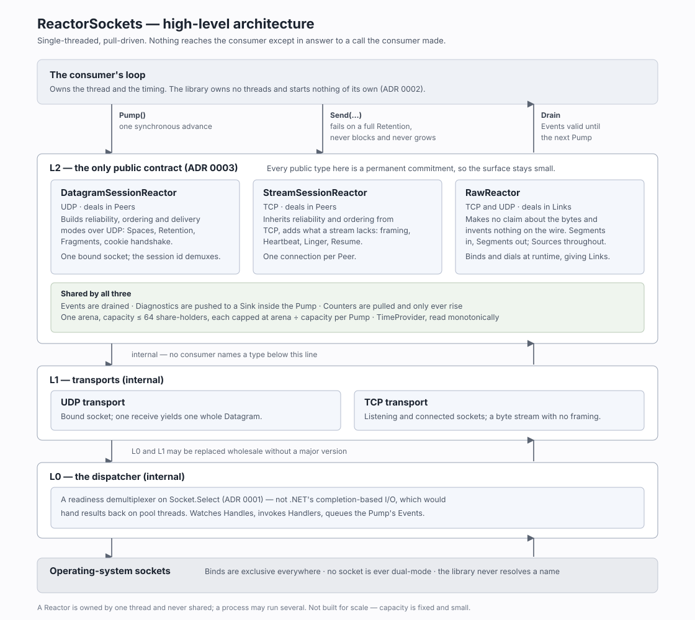

# ReactorSockets

A single-threaded, pull-driven networking library for .NET 8 applications that already own a loop.
Your loop decides when networking happens. Nothing reaches your code except in response to a call
you made.

## Why this library

.NET's socket API is completion-based. `async`/`await` and `SocketAsyncEventArgs` hand results back
on thread-pool threads, at moments the caller does not control. An application that already runs its
own loop has to marshal those results back onto its thread, with locks or queues, and loses control
over when the work happens.

ReactorSockets inverts that. It is a **Reactor**: one synchronous `Pump()` on your thread checks
which sockets are ready with `Socket.Select`, moves the bytes that are waiting, and queues the
results. `Drain()` then hands them to you. This gives four properties:

- **The library owns no threads.** Every socket operation, retransmit and timer runs inside `Pump`.
- **No locks, no callbacks.** One thread owns a Reactor, so nothing needs synchronisation.
- **Memory fixed by your options.** Buffers are preallocated at construction, and every cost is
  stated as a formula you can check before the first byte arrives.
- **Bounded work per Pump.** Reads, accepts and handshakes are capped, so no remote party can make
  one Pump arbitrarily long.

The cost is scale. `Socket.Select` is O(n) in the watched sockets, so the library suits Reactors that
hold tens of Peers or Links and is unsuitable above the low hundreds. See
[ADR 0001](docs/adr/0001-readiness-based-reactor-over-socket-select.md) and
[ADR 0002](docs/adr/0002-the-library-owns-no-threads.md).

## Architecture



Three layers live in one assembly. L0 is the readiness dispatch and the per-Pump budget. L1 wraps
each socket kind. L2 is the public surface: the Reactors, their Events, options and counters. Only
L2 is public and part of the contract
([ADR 0003](docs/adr/0003-layer-2-is-the-only-public-contract.md)).

## Pick a profile

| Profile | Transport | Addresses | Use it when |
|---|---|---|---|
| [`DatagramSessionReactor`](docs/api/datagram-session-api/README.md) | UDP | Peers | You want whole Messages with a choice of four delivery modes, fragmentation and Session resume. |
| [`StreamSessionReactor`](docs/api/stream-session-api/README.md) | TCP | Peers | You want whole Messages delivered reliably and in order, with automatic re-dial and resume. |
| [`RawReactor`](docs/api/raw-api/README.md) | UDP and TCP | Links | You are writing your own protocol and want sockets driven by the same loop, with nothing added on the wire. |

## Using it

Every profile follows the same four steps.

1. **Construct** a Reactor from its options. Everything is validated and allocated here, and a bad
   combination throws with the arithmetic in the message.
2. **Pump** once per iteration of your loop. `Pump` never blocks.
3. **Drain** the Events that Pump produced, and act on each one. A Payload is valid only until the
   next Pump, so copy out anything you keep.
4. **Send**, **Connect** and **Close** whenever you like. The bytes go out on the next Pump.

```csharp
using System.Net;
using ReactorSockets;

using var reactor = new DatagramSessionReactor(new DatagramSessionOptions
{
    Reactor = new ReactorOptions { Capacity = 64 },
    MaxMessageSize = 64 * 1024,
    RetentionBytes = 256 * 1024,
    SendIdleInterval = TimeSpan.FromSeconds(5),
    Linger = TimeSpan.FromSeconds(30),
    Endpoints = [new IPEndPoint(IPAddress.Loopback, 9000)],
});

while (running)
{
    reactor.Pump();

    foreach (SessionEvent evt in reactor.Drain())
    {
        switch (evt.Kind)
        {
            case SessionEventKind.PeerConnected:
                reactor.Send(evt.Peer, DeliveryMode.ReliableOrdered, "hello"u8);
                break;
            case SessionEventKind.MessageReceived:
                Handle(evt.Peer, evt.Payload);   // copy out if you keep it
                break;
            case SessionEventKind.PeerClosed:
                Forget(evt.Peer, evt.Reason);
                break;
        }
    }

    Thread.Sleep(1);   // your loop paces itself
}
```

The stream profile has the same shape without the `DeliveryMode`. The Raw profile uses `RawEvent`
and `LinkId` in place of `SessionEvent` and `PeerId`. Each profile's guide has its own smallest
working program.

## Further reading

| Read | For |
|---|---|
| [Datagram Session guide](docs/api/datagram-session-api/README.md) | Construction, the loop, Messages, closing, resume, counters and diagnostics over UDP. |
| [Stream Session guide](docs/api/stream-session-api/README.md) | The same topics over TCP, plus re-dial. |
| [Raw guide](docs/api/raw-api/README.md) | Links, datagrams, streams, closing, counters and diagnostics. |
| [Choosing a delivery mode](docs/delivery-modes.md) | Four questions that pick a datagram delivery mode, and what each mode promises. |
| [Options and what they cost](docs/options.md) | Every knob and its default, what you cannot set, and the memory each profile preallocates. |
| [API reference](docs/api/markdown/README.md) | Every public type and member. A searchable HTML copy is in `docs/api/docfx`: serve it with `docfx serve docs/api/docfx`. |
| [`ReactorSockets.Logging`](src/ReactorSockets.Logging/README.md) | A Sink that writes diagnostics to `Microsoft.Extensions.Logging`. |
| [Architecture decisions](docs/adr) | Why the library is shaped the way it is. |
| [Changelog](docs/change%20logs/CHANGELOG.md) | What 1.0 contains and the risks it leaves open. |

## License

[MIT](LICENSE).
